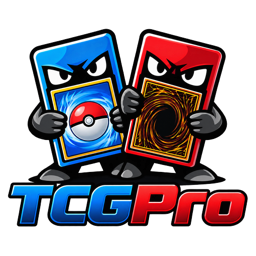
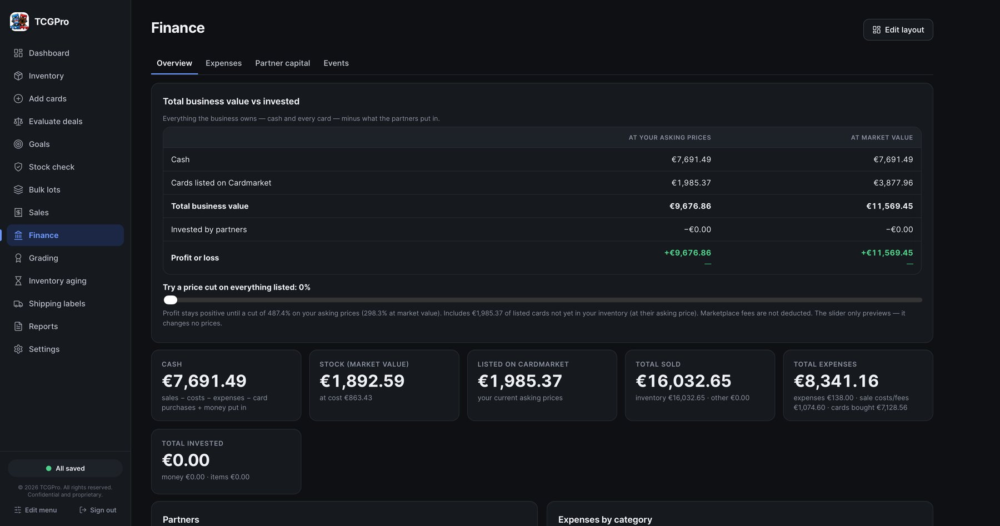
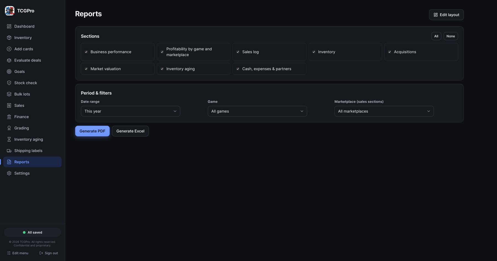

# TCGPro

Run your card business without the spreadsheets. Mac and Windows.

<a href="#a-look-inside">Screens</a> · <a href="#install">Install</a> · <a href="#pricing">Pricing</a> · <a href="#faq">FAQ</a>

Sample data.

A desktop app for Pokémon, One Piece and Riftbound sellers. It syncs your Cardmarket stock, lists on eBay in two clicks and shows your profit after fees.

**Free to download, free for 14 days, no card.** Install it, then decide.

---

## What it does

- **Cardmarket stock sync** — press Sync and TCGPro reads your own stock, read-only. No retyping.
- **List on eBay in two clicks** — with your own eBay keys, TCGPro fills in the title, item specifics, price and description, and reads your orders and fees. Without them, a copy-and-paste listing helper.
- **Real profit, not guesses** — FIFO cost of every card sold, after fees and postage.
- **Inventory in order** — every card, condition and quantity, with its cost and Cardmarket price.
- **Stock check and bulk lots** — cards sold elsewhere that may still be live, and cheap cards turned into priced eBay lots.
- **Finance, PDF and Excel** — cash, stock value, expenses and partners, plus grading and goals.

---

## A look inside

<b>One more screen: Reports</b>

---

## Install

Same app, same price on both. Download from the Releases page.

### macOS

1. Unzip it and drag **TCGPro** into Applications.
2. Double-click it. macOS says it cannot verify TCGPro: click **Done**, not Move to Bin.
3. Open **System Settings → Privacy & Security**, scroll down, click **Open Anyway**. Once per Mac.
4. Type your email to start the free trial.

### Windows

1. Unzip it. You get a folder called TCGPro.
2. **Put that folder on your C: drive, so it is `C:\TCGPro`.** Not the Desktop, not Documents, not a OneDrive folder, not Program Files.
3. Open it and double-click **TCGPro**, the one with the TCGPro icon. Never from inside the zip.
4. If Windows says *Windows protected your PC*: **More info**, then **Run anyway**. Once.
5. Type your email to start the free trial.

**Updating on Windows: close TCGPro and delete the old folder first.** Never unzip over it: TCGPro checks its own files at every start and refuses to run if one is missing, changed or not on its list. Your data lives in `%APPDATA%\TCGBusinessSuite`; updates never touch it.

## Pricing

- **Free for 14 days, no card.** Then **€9.99 a month or €99.99 a year**, inside the app.
- **Cancel any time**, to the end of the paid period.
- If it lapses, TCGPro turns read-only — not locked: read and export as before.
- One subscription covers **up to 2 of your computers**, Mac or Windows.

[Refund policy](https://mytcgpro.com/policies/refund-policy). Prices in euros.

## Requirements

| | macOS | Windows |
| --- | --- | --- |
| Operating system | 13 or later (Apple silicon or Intel) | 10 or 11 (64-bit) |
| Browser | not needed | Microsoft Edge (comes with Windows) or Google Chrome |
| Cardmarket sync | built in | a small extension, supplied with the download |

Internet needed for the trial, the subscription and prices.

## Privacy

Your stock, costs and sales stay on your own computer, encrypted with your password and a recovery key only you hold. Nothing is sent to us but your email, your licence key and a code for your computer. Cardmarket is read, never written. Full detail: the [privacy policy](https://mytcgpro.com/policies/privacy-policy).

## FAQ

<b>Does the eBay integration work out of the box?</b>

The listing helper does. The automatic side — orders, fees and the **List on eBay** button — needs two things first: your own eBay developer keys, and **a listing already live on your eBay account** — TCGPro copies its category, shipping, payment and return policies and location. Without both, type eBay sales in by hand.

<b>Do I need a browser extension for the Cardmarket sync?</b>

Not on a Mac: it runs inside the app. On Windows you load a small extension into Edge or Chrome once; it comes with the download and TCGPro shows you the folder.

<b>I bought TCGPro before. Do I pay again?</b>

No. On the first screen choose **I already have a licence key or an order number** and enter it.

## Support

Questions or a problem? Use the contact form: **https://mytcgpro.com/pages/contact**

There is also a Discord community for TCGPro users: **https://discord.gg/pTQKMzCyY**

Never send your password or recovery key — you will never be asked for them.

---

## About this repository

Just the free download, the user guide and the licence terms. TCGPro is proprietary software, licensed and not sold: no source code here, and the download is free of charge, not free to copy or redistribute. Issues are off.

---

TCGPro is independent software, not affiliated with Cardmarket, eBay or any card publisher. All product names belong to their owners. Figures are estimates, not tax or accounting advice.

<a href="LICENSE">LICENSE</a> · <a href="THIRD_PARTY_NOTICES.txt">Third-party notices</a> · <a href="docs/USER_GUIDE.md">User Guide</a>

