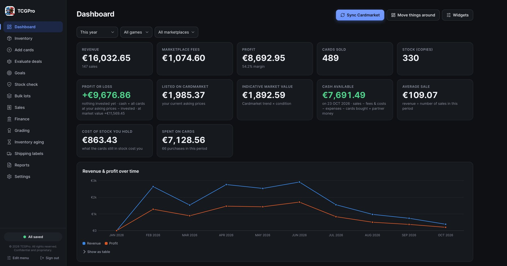
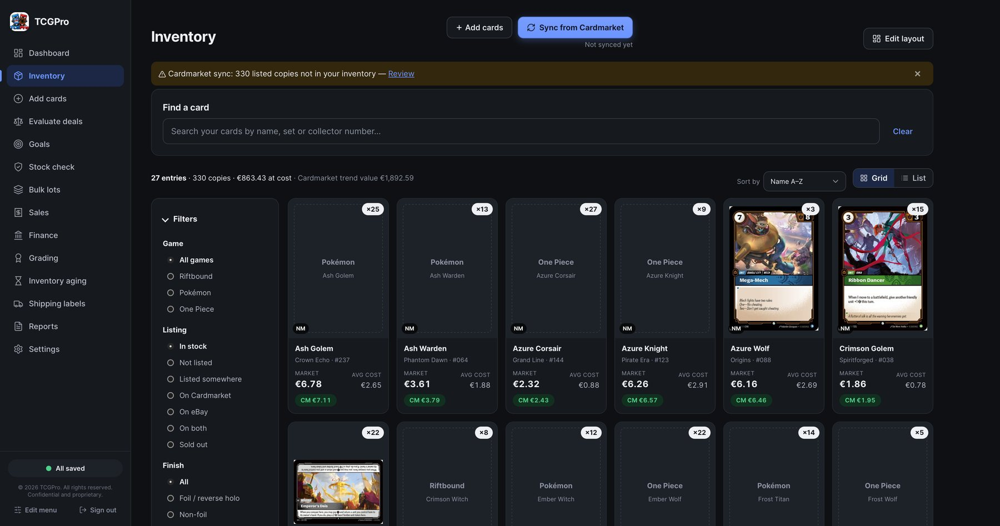
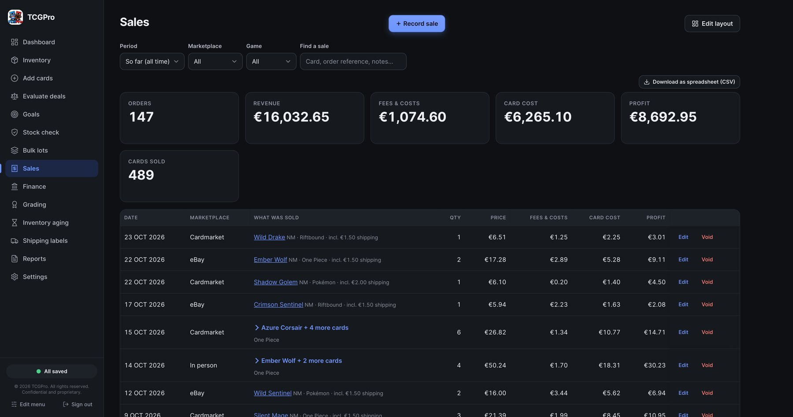

<div align="center">


# TCGPro

Inventory, sales and real profit for Pokémon, One Piece and Riftbound sellers — on your own computer.

[](#)
[](#requirements)
[](#requirements)
[](#pricing)
[](LICENSE)

[](../../releases/latest)
[](../../releases/latest)

<a href="#a-look-inside">Screens</a> · <a href="#install">Install</a> · <a href="#pricing">Pricing</a> · <a href="#faq">FAQ</a>

</div>



<p align="center"><sub>The dashboard. All screenshots on this page show sample data.</sub></p>

TCGPro is a desktop app for people who buy and sell trading cards. It keeps your stock, your costs and your sales in one place, works out your profit from what you actually paid for each copy, and gives you the figures and reports a card business needs.

It is built for sellers who have outgrown spreadsheets: Cardmarket sellers, eBay sellers, and anyone tracking cost, condition and quantity across Pokémon, One Piece and Riftbound.

It runs on macOS and on Windows 10 or 11. Your data lives in a folder on your own computer, and the download is free to try for 14 days before you decide anything.

---

## Why TCGPro

- **You know your real profit.** Each sale is costed against the oldest copy you bought, minus marketplace fees and postage — not a guess from the market price.
- **You stop retyping your Cardmarket stock.** Press Sync and TCGPro reads your own Cardmarket stock and tells you what changed.
- **You stop selling the same card twice.** Stock check lists cards you sold elsewhere that are probably still live on Cardmarket.
- **Your cheap cards stop clogging your stock.** Bulk lots turns them into priced eBay lots with a ready title and description.
- **You can hand numbers to an accountant.** Reports as PDF, exports as Excel, expenses and partner capital in one Finance screen.
- **Your data stays on your own computer** and you can always export it, including after a trial or subscription ends.
- **One app instead of several spreadsheets**, with most screens laid out the way you arrange them.

## What it does

- **Inventory** — every card with condition, language, edition, foil, quantity and what you actually paid.
- **Live Cardmarket prices** — reference price, lowest listing, 1/7/30-day averages and the trend since you bought.
- **Recommended prices** per marketplace, with every step of the calculation shown, fees and profit included.
- **Cardmarket sync** — press Sync. On a Mac it is built in, with nothing to install; on Windows it uses a small browser extension that comes with TCGPro and is loaded once in Edge or Chrome.
- **eBay listing helper** — title, item specifics and description ready to copy; full eBay integration if you add your own developer keys.
- **Real FIFO profit** — each sale costed against the oldest copy you bought, after fees and postage.
- **Finance and reports** — business value, expenses, partner capital, PDF reports and Excel exports.
- **Shipping labels, bulk lots, grading, goals and aging** — the day-to-day jobs, in the same app.

<details>
<summary><b>Everything, in detail</b></summary>

<br>

**Inventory and pricing**
- Every card with its condition, language, edition, foil, quantity and average cost; identical copies group automatically.
- Current Cardmarket reference price per card, with the lowest listing, the 1/7/30-day averages and the trend recorded from the day you hold the card.
- Recommended prices worked out separately for Cardmarket and eBay, showing every step: reference, condition factor, strategy %, optional undercut, rounding, minimum price, fees, card cost and expected profit — or the expected loss, in red.
- Missing, stale and volatile prices are flagged instead of being used silently; you enter the value yourself and it is kept as a manual value with its date.
- Pricing strategies per marketplace, with rules per game or price range, and condition factors you set.
- Filters that combine condition, language, edition, foil, listing status, quantity, cost range and price range. Reprice a whole selection in one go.

**Cardmarket sync**
- Built into the Mac app: press Sync and Cardmarket is read in the background, with progress shown in the sync window. Nothing to install.
- On Windows the sync works through a small browser extension that comes with TCGPro. You load it into Microsoft Edge or Google Chrome once; TCGPro keeps its own copy of the extension up to date, and the Cardmarket page in the app shows you the exact folder.
- Reads the stock of all three games, and reports what is on Cardmarket but not in your inventory so you can add it with a cost basis.
- Read-only on Cardmarket's side: TCGPro reads your stock, it does not change or remove your Cardmarket listings for you.
- Cardmarket sales can be pre-filled with Scan sales — orders are matched by order number, so nothing is added twice — and you can print a packing list.

**eBay (optional, advanced)**
- A listing helper that gives you an eBay title of up to 80 characters, the item specifics and a description, ready to copy.
- If you connect your own eBay developer keys, TCGPro can read your orders, fees and active listings, keep your eBay quantities in line with your stock, and list a card when you press **List on eBay** on that card. This is optional: eBay may require extra approval before it issues production keys, and you can type eBay sales in by hand instead.
- An eBay plan screen that sorts your stock into fast, middle and premium sales with a suggested price and what you keep after fee and postage.

**Buying and evaluating**
- Record a purchase with its source, total paid and cards, splitting the cost by market value, equally, or line by line.
- Quick deal calculator: what a card on offer is worth, what it resells for on each marketplace, the fees and the profit.
- Collection analysis: estimated market value against the asking price, as a figure and as a % of market value, with unpriced cards flagged.

**Sales, aging and goals**
- One sales list with marketplace, quantity, price, fees and profit; void restores stock and costs exactly.
- Sales not from inventory can be recorded too, marked as such.
- Aging shows how long copies have been held, lists slow movers and suggests price cuts, which only apply when you press Apply.
- Goals for profit, sales or stock levels, tracked against your real figures, with proposed next objectives.

**Finance and reports**
- Business value (cash plus stock at asking and market prices) minus what partners put in, expenses by category, partner capital and dated business events.
- Reports as PDF across business performance, profitability, sales log, inventory, acquisitions, market valuation and aging; Excel exports.
- A dashboard you arrange yourself: revenue, fees, realised profit, cards sold, stock at cost, acquisition spend, trends, best sellers and more, each chart viewable as a table.

**Day-to-day extras**
- Shipping labels: 13 × 6 cm address labels, 6 to an A4 sheet sideways or 4 upright, starting at whichever position on the sheet is still free.
- Grading tracker: cost, raw value, graded value and win/loss per card.
- Activity log of every change to stock, costs, prices, sales and settings.
- Backup and restore, including an external drive and automatic backups.
- Seven interface languages: English, Français, Deutsch, Español, Italiano, Português, Nederlands. Your own data is never translated.

</details>

---

## A look inside



<p align="center"><sub>Inventory — search, filter and price every card you hold.</sub></p>



<p align="center"><sub>Sales — every order with its fees, card cost and profit, exportable as CSV.</sub></p>


<p align="center"><sub>Finance — what the business is worth against what went into it.</sub></p>

<details>
<summary><b>One more screen: Reports</b></summary>


<sub>Reports — pick the sections you want, then generate a PDF or an Excel file.</sub>

</details>

---

## Install

TCGPro runs on macOS and on Windows 10 or 11, 64-bit. It is the same app on both: the same features, the same prices and the same licence. Windows support is new — 2.3.6 is the first Windows release.

Already bought TCGPro earlier? Choose **I already have a licence key or an order number** on the first screen and enter your order number or key.

TCGPro checks its own files at every start and refuses to run if any of them were changed.

### macOS

macOS will warn you the first time you open TCGPro. That is expected: TCGPro is distributed directly rather than through the App Store, and it is ad-hoc signed, not notarized. macOS therefore asks you to confirm it once. Takes about a minute, once per Mac.

1. **Download the macOS zip** — the file ending in `-mac.zip` — from the Releases page of this repo, and unzip it.
2. **Drag TCGPro into your Applications folder.**
3. **Double-click TCGPro.** macOS says *"TCGPro" Not Opened*. Click **Done**. Do not click "Move to Bin" (shown as "Move to Trash" on some systems).
4. **Open the Apple menu → System Settings → Privacy & Security** and scroll down to the Security section. It says *"TCGPro" was blocked to protect your Mac*. Click **Open Anyway** and confirm with your Mac password or Touch ID.
5. **Click Open** in the last box. From now on TCGPro opens with a normal double-click.
6. **Type your email to start the 14-day free trial.** No card is needed. You will also set your password here.

On macOS versions before 15 you can instead right-click TCGPro, choose **Open**, then click **Open**.

If it still will not open, run this in Terminal, then open TCGPro normally:

```
xattr -dr com.apple.quarantine /Applications/TCGPro.app
```

### Windows

TCGPro for Windows is a zip folder, not an installer. Windows may warn you the first time you open it. That is expected: TCGPro is sold directly rather than through the Microsoft Store, and it is not signed with a paid Windows publisher certificate, so Windows asks you to confirm it once. Takes about two minutes, once.

1. **Download the Windows zip** — the file ending in `-windows.zip` — from the Releases page of this repo.
2. **Unzip it. You get a folder called TCGPro: put that whole folder straight on your C: drive**, so that it is `C:\TCGPro` (recommended). Not your Desktop, not your Documents folder, not a OneDrive folder, and not Program Files. Do not run TCGPro from inside the zip file.
3. **Open the folder and double-click TCGPro** — the program with the TCGPro icon.
4. **If Windows shows *Windows protected your PC*,** click **More info**, then click **Run anyway**.
5. **TCGPro opens in its own window**, using Microsoft Edge (it comes with Windows) or Google Chrome.
6. **Type your email to start the 14-day free trial.** No card is needed. You will also set your password here.

Your data is kept separately from the program, in `%APPDATA%\TCGBusinessSuite`.

**The Cardmarket sync, if you want it, needs a small browser extension once.** TCGPro comes with the extension and keeps its own copy in `%APPDATA%\TCGBusinessSuite\cardmarket-sync-extension`, which survives moving or updating the TCGPro folder. In TCGPro, open the Cardmarket page and press **Open Chrome extensions page** and **Show the folder**. In Microsoft Edge (`edge://extensions`) switch on **Developer mode**, click **Load unpacked** and choose that folder. Google Chrome: the same steps at `chrome://extensions`. Choose the folder the Cardmarket page shows you, not a folder inside the one you unzipped.

**Updating TCGPro later.** Your data stays in `%APPDATA%\TCGBusinessSuite` and an update never touches it.

1. Close TCGPro.
2. **Delete the old TCGPro folder.** Do not unzip the new version on top of the old one: files left over from the old version make TCGPro refuse to start, because it checks its own files against a signed list and a leftover file is a file that should not be there.
3. Unzip the new zip and put its TCGPro folder in the same place (`C:\TCGPro`), then open TCGPro as before. Windows may show the *Windows protected your PC* screen again: **More info**, then **Run anyway**.

<p align="center">
<a href="../../releases/latest"></a>
<a href="../../releases/latest"></a>
</p>

## Pricing

- **The download is free**, and so is the trial.
- **14 days, everything working, no payment card.** One trial per person and per computer.
- **Then €9.99 per month or €99.99 per year**, paid inside the app. Payment happens on Stripe's own secure page; your card details never reach TCGPro.
- **Cancel any time** in *Settings → About → Subscription*. You keep full access until the end of the period you have paid for.
- **If a payment fails**, TCGPro keeps working for a week while the payment is retried and asks you to update your payment method.
- **When a trial or subscription ends, nothing is locked away.** TCGPro opens read-only: you can still open every screen, generate PDF reports, export to Excel and take backups. You cannot add or change things until you subscribe again. Your data is never deleted or held back.
- **One subscription covers up to 2 computers at a time.** Your licence key is in *Settings → About*; keep it to set up a new computer.
- Prices are in euros. Refunds follow the refund policy at https://mytcgpro.com/policies/refund-policy

| Plan | Price |
| --- | --- |
| Free trial | 14 days, no card |
| Monthly | EUR 9.99 / month |
| Yearly | EUR 99.99 / year |

## Requirements

- macOS 13 or later, or Windows 10 or 11, 64-bit.
- On a Mac, Apple silicon or Intel — one universal build runs natively on both.
- On Windows, Microsoft Edge (it comes with Windows) or Google Chrome: TCGPro uses one of them to draw its own window.
- An internet connection to start the trial, and from time to time afterwards to keep a subscription up to date. Cardmarket prices, card pictures and the optional Cardmarket and eBay features also need the internet.
- The Cardmarket sync is built into the Mac app, with no browser extension to install. On Windows it uses a small browser extension that comes with TCGPro, loaded once in Edge or Chrome.
- The Windows version is a zip folder you unzip yourself, not an installer.

| | macOS | Windows |
| --- | --- | --- |
| Operating system | 13 or later (Intel and Apple silicon) | 10 or 11 (64-bit) |
| Download | about 92 MB | about 44 MB |
| Installed size | about 215 MB | about 87 MB |
| Cardmarket sync | built in, nothing to install | a small extension, supplied with TCGPro |

## Privacy

- **Your business data stays on your own computer.** Stock, costs, sales, expenses and settings live in a data folder there; *Settings → About* shows you exactly where it is.
- **It is encrypted and locked with your password** (AES-256, with a scrypt-derived key), and a recovery key only you hold. If you lose both your password and your recovery key, nobody can open your data — not even us.
- **Automatic backups** are made for you, and you can back up to an external drive from *Settings → Backup & restore* at any time.
- **Your inventory, sales and passwords are never sent to us.** Per the licence agreement, the only data TCGPro sends to its licence service is your email address, your licence key, a code of your computer, its name and the program version — enough to start your trial and keep your subscription up to date. The Cardmarket and eBay bullets below cover the connections you choose to make yourself.
- **Payments are handled by Stripe** on its own page. TCGPro never sees your card details.
- **Cardmarket is read, never written.** When you press Sync, TCGPro reads your own logged-in Cardmarket pages. It does not change or remove your listings — you do that yourself.
- **eBay only if you ask for it.** Nothing goes to eBay unless you connect your own eBay developer keys. With that connection a listing is created only when you press *List on eBay* on that card, and TCGPro keeps your eBay quantities in line with your stock.
- **Buyers' addresses used for shipping labels stay on your own computer**, are not sent anywhere and are never written to the audit log, and printed labels are deleted automatically.
- **Seller contact details** you record with a purchase are stored encrypted.
- **Every change is logged locally** in the activity log, so you can see what happened to stock, costs, prices, sales and settings.

## FAQ

<details>
<summary><b>Is this repo the source code?</b></summary>

No. TCGPro is proprietary software; this repo exists to give you the download, the user guide and the licence terms. There is no source code here.

</details>

<details>
<summary><b>Why does macOS say it cannot verify TCGPro?</b></summary>

Because it is distributed directly rather than through the App Store, and it is ad-hoc signed rather than notarized. macOS asks you to confirm it once, in System Settings → Privacy & Security → Open Anyway. The Install steps above walk through it, and the same steps are in the download.

</details>

<details>
<summary><b>Why does Windows say "Windows protected your PC"?</b></summary>

Because TCGPro is sold directly rather than through the Microsoft Store, and it is not signed with a paid Windows publisher certificate. Click **More info**, then **Run anyway**. Windows asks the first time you open it. The Install steps above walk through it, and the same steps are in the download.

</details>

<details>
<summary><b>What do I need to pay to try it?</b></summary>

Nothing. The download is free and the 14-day trial needs no payment card. You only pay if you decide to subscribe.

</details>

<details>
<summary><b>What happens to my data if I stop paying?</b></summary>

It stays yours and stays on your own computer. TCGPro opens read-only: you can look at everything, generate reports, export to Excel and take backups, but not add or change entries until you subscribe again.

</details>

<details>
<summary><b>Do I need a browser extension for the Cardmarket sync?</b></summary>

Not on a Mac. There the sync runs inside the app: the first time, and occasionally after that, a small Cardmarket window appears so you can log in or tick Cardmarket's "verify you are human" box, and the sync then carries on by itself.

On Windows you do, once. The extension comes with TCGPro, which keeps its own copy of it in `%APPDATA%\TCGBusinessSuite\cardmarket-sync-extension`. Open the Cardmarket page in TCGPro: it shows you that folder and has buttons to open the extensions page and show the folder. You load it into Microsoft Edge or Google Chrome once, and stay signed in to Cardmarket in that browser.

</details>

<details>
<summary><b>Does the eBay integration work out of the box?</b></summary>

The listing helper does — it gives you the title, item specifics and description to copy. The automatic side (reading your orders and fees, and the *List on eBay* button) needs your own eBay developer keys, which is an advanced, optional step; eBay may ask for extra approval before issuing production keys. You can type eBay sales in by hand instead.

</details>

<details>
<summary><b>Is there a Windows version?</b></summary>

Yes, from 2.3.6, for Windows 10 and 11, 64-bit. It is the same app as the Mac version, with the same features, the same prices and the same licence. It comes as a zip folder rather than an installer: unzip it, put the TCGPro folder on your C: drive and double-click TCGPro.

</details>

## Support

Questions, a problem, or something that does not work? Use the contact form: **https://mytcgpro.com/pages/contact**

It helps to say which TCGPro version you are on (*Settings → About*) and what you see on screen. Never send your password or your recovery key — you will never be asked for them.

There is also a Discord community for TCGPro users: **https://discord.gg/pTQKMzCyY**

Issues are turned off on this repository, because it holds no source code.

---

## About this repository

A free download page for TCGPro, plus the user guide and the licence terms. TCGPro is proprietary software, licensed and not sold: no source code is published here, and the download is free of charge, not free to copy, modify or redistribute. See [LICENSE](LICENSE).

---

<div align="center">

<sub>TCGPro is independent software. It is not affiliated with, endorsed by or sponsored by Cardmarket, eBay, The Pokémon Company, Nintendo, Game Freak, Creatures, Riot Games, Bandai, or any other game maker or marketplace. All product names, card names and trademarks belong to their owners and are used only to identify the cards you trade.</sub>

<sub>TCGPro is proprietary software — see <a href="LICENSE">LICENSE</a> and <a href="THIRD_PARTY_NOTICES.txt">third-party notices</a>.<br>
Full documentation: <a href="docs/USER_GUIDE.md">User Guide</a>.</sub>

</div>
